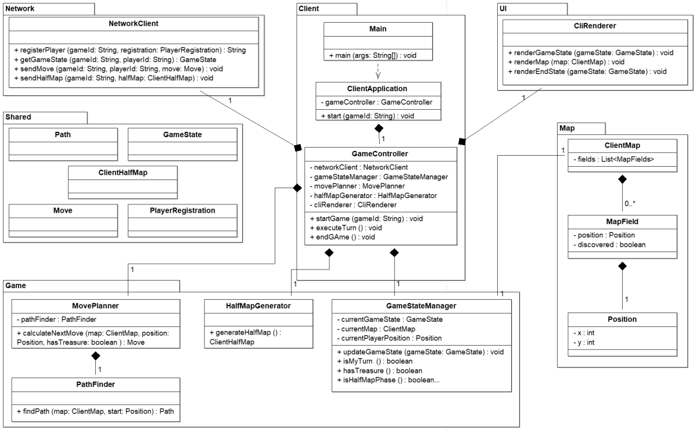
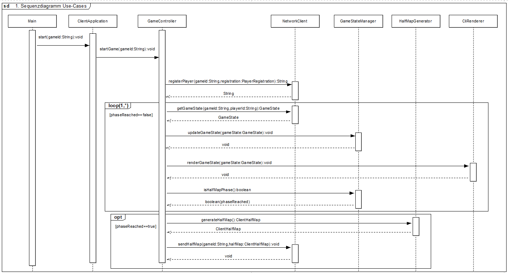
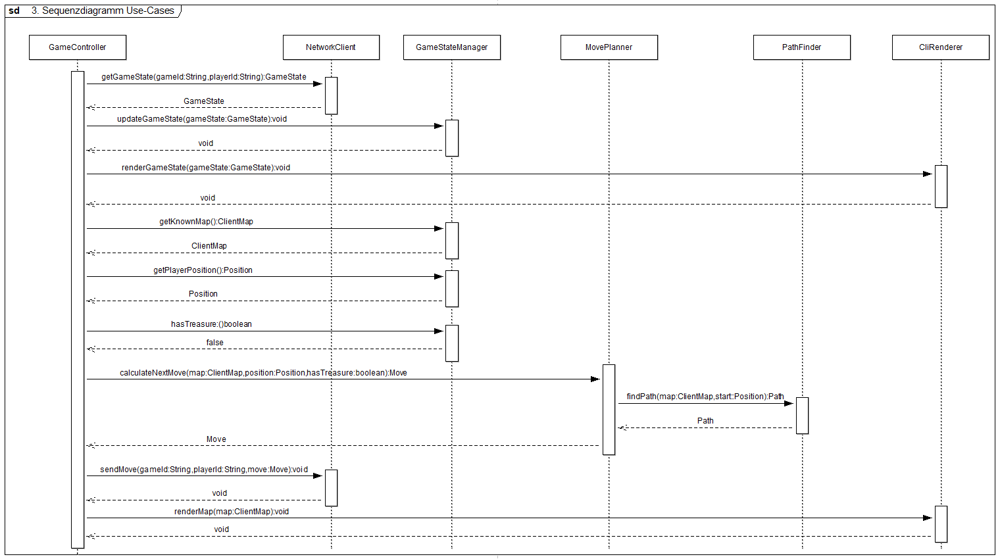

# Software Engineering I - Teilaufgabe 1 (Anforderungsanalyse und Planungsphase)

## Abgabedokument - Teilaufgabe 1 (Anforderungsanalyse und Planungsphase)

- Nachname, Vorname: Polovko Ivan
- Matrikelnummer: 12232715

## Aufgabe 1: Anforderungsanalyse

### Quellen dokumentieren - Aufgabe 1: Anforderungsanalyse

- **Kurzbeschreibung der übernommenen Teile**:  
  Die Anforderungen wurden auf Basis der bereitgestellten **Spielidee** des Übungsprojekts erstellt. Aus diesem Dokument wurden zentrale Inhalte analysiert und daraus mehrere funktionale und nichtfunktionale Anforderungen sowie eine Designbedingung abgeleitet.  
  Übernommen wurden die grundlegenden **Ideen und Spielmechaniken** (z. B. Bewegung über die Karte, Finden des Schatzes, Zeitlimit der Aktionen, Client-Server Architektur).

- **Quellen der übernommenen Teile**:
  - Dokument **„Spielidee“** aus den Unterlagen der Lehrveranstaltung
  - Kursmaterialien / Repository der Lehrveranstaltung Software Engineering
  - Vorlage und Aufgabenbeschreibung im GitLab-Repository

### Typ der Anforderung: funktional

- **Anforderung**: Karte erkunden und eigenen Schatz finden – Der Client muss seine Spielfigur über die Spielkarte bewegen, um schrittweise neue Kartenfelder aufzudecken und dadurch den eigenen Schatz zu finden.
- **Bezugsquelle**: Spielidee, **Zitat**
  > „Um den Schatz zu finden, bewegen beide KIs ihre Spielfigur über die Karte und decken dabei mit ihrer Spielfigur schrittweise Kartenfelder auf.”

  **Anforderung 2**

- **Anforderung**: Kartenhälfte erzeugen und an Server senden – Der Client muss eine eigene Kartenhälfte erzeugen und diese an den Server übertragen, damit die vollständige Spielkarte erstellt werden kann.
- **Bezugsquelle**: Spielidee, **Zitat**
  > „Nach Start des Clients registrieren sich die KIs für das Spiel am Server und erstellen/tauschen danach mit dem Server Kartenhälften aus.“

**Anforderung 3**

- **Anforderung**: Nach Schatzfund gegnerische Burg suchen – Nachdem der Client den eigenen Schatz gefunden hat, muss er die gegnerische Burg auf der Karte suchen und dorthin navigieren.
- **Bezugsquelle**: Spielidee, **Zitat**
  > „Sobald eine KI "ihren" Schatz gefunden bzw. aufgedeckt hat, muss sie ihre Spielfigur zu diesem bewegen, um ihn aufnehmen zu können. Danach, sobald der Schatz aufgenommen wurde, muss die KI mit ihrer Spielfigur die gegnerische Burg finden.“

### Typ der Anforderung: nicht funktional

**Anforderung 4**

- **Anforderung**: Spielaktionen innerhalb von Zeitlimit durchführen – Der Client muss jede Spielaktion innerhalb von maximal 5 Sekunden durchführen, damit das Spiel korrekt fortgesetzt werden kann.
- **Bezugsquelle**: Spielidee, **Zitat**
  > „Um die Spiele für die Zuschauer spannend zu gestalten, wurde festgelegt, dass ein Spiel insgesamt nicht länger als 320 Spielaktionen (und damit 320 Runden) dauern darf. Für jede dieser rundenbasierten Spielaktion hat die KI maximal 5 Sekunden Bedenkzeit. Insgesamt dauert ein Spiel maximal 10 Minuten.“

**Anforderung 5**

- **Anforderung**: Autonome Spielentscheidungen treffen – Der Client muss das Spiel autonom ausführen und Entscheidungen ohne menschliche Eingriffe treffen.
- **Bezugsquelle**: Spielidee, **Zitat**
  > „Die KI entscheidet selbst, ohne menschliches Zutun, wie hierzu am Besten vorzugehen ist.“

**Anforderung 6**

- **Anforderung**: Spielzustände korrekt anzeigen – Der Client muss vom Server gemeldete Gegnerpositionen auch bei ungewöhnlichen Positionsänderungen im Client-UI anzeigen.
- **Bezugsquelle**: Spielidee, **Zitat**
  > „Zufällige Position des Gegners: Bis zum Abschluss der ersten 8 eigenen Clientaktionen hat die vom Server gemeldete Position des Gegners zufällig zu sein. Dies kann zu unerwarteten Positionen und vermeintlichen Sprüngen zwischen Feldern für den Gegner führen. Zeigen Sie diese trotzdem einfach im Client-UI an.“

### Typ der Anforderung: Designbedingung

**Anforderung 7**

- **Anforderung**: Client-Server Architektur verwenden – Das System muss eine Client-Server Architektur verwenden, bei der Clients über einen Server miteinander interagieren.
- **Bezugsquelle**: Spielidee, **Zitat**
  > „Die Grobarchitektur ist damit als klassische Client/Server Architektur vorgegeben.“


## Aufgabe 2: Anforderungsdokumentation

### Quellen dokumentieren - Aufgabe 2: Anforderungsdokumentation

- **Kurzbeschreibung der übernommenen Teile**: Inhalte basieren auf der in Aufgabe 1 ausgewählten funktionalen Anforderung „Client muss die Karte erkunden, um den eigenen Schatz zu finden“. Übernommen wurden zentrale Inhalte aus der "Spielidee".
- **Quellen der übernommenen Teile**: Spielidee, Netzwerkprotokoll, eigene Ausarbeitung aus Aufgabe 1, Vorlage.md im GitLab-Repository.

- **Name**: Karte erkunden und eigenen Schatz finden
- **Beschreibung und Priorität**: Der Client muss seine Spielfigur über die Spielkarte bewegen, um schrittweise neue Kartenfelder aufzudecken und dadurch den eigenen Schatz zu finden. Die Anforderung ist zentral für den Spielverlauf, da ohne das Erkunden der Karte der Schatz nicht gefunden werden kann und der Client das Spielziel nicht weiterverfolgen kann. 
- **Priorität: Hoch**

### Relevante Anforderungen:
  - **Client muss eine Kartenhälfte erzeugen und übertragen**: Die Karte muss zunächst korrekt erzeugt und an den Server übertragen werden, bevor sie im weiteren Spielverlauf erkundet werden kann.
  - **Client muss nach dem Finden des Schatzes die gegnerische Burg suchen**: Das Erkunden der Karte ist die Voraussetzung dafür, den eigenen Schatz zu finden und anschließend die gegnerische Burg zu suchen.
  - **Client muss Spielaktionen innerhalb einer bestimmten Zeit durchführen**: Das Erkunden der Karte erfolgt über Spielaktionen, die innerhalb des vorgegebenen Zeitlimits durchgeführt werden müssen.
  - **Client muss autonom ohne menschliches Eingreifen arbeiten**: Die Erkundung der Karte muss vollständig durch die Client-KI geplant und ausgeführt werden.
  - **Client muss Spielzustände korrekt anzeigen**: Die bei der Erkundung gewonnenen Informationen müssen korrekt im Client-UI dargestellt werden.
  - 
    ### Relevante Business Rules**:
  - Die Spielfigur darf sich nur gemäß der Spielregeln über die Karte bewegen.
  - Durch Bewegungen werden Kartenfelder schrittweise aufgedeckt.
  - Der eigene Schatz befindet sich auf der eigenen Kartenhälfte und kann nur vom jeweiligen Client gefunden und aufgenommen werden.
  - Der Client darf nur dann eine Bewegungsaktion ausführen, wenn er laut Spielstatus an der Reihe ist.
  - Der Client muss die vom Server gelieferten Spielzustände als verbindlich behandeln.
  - Eine Spielaktion muss innerhalb der vorgegebenen Bedenkzeit durchgeführt werden.

### Impuls/Ergebnis - Typisches Szenario

**Vorbedingungen:**

- Der Client wurde gestartet und erfolgreich beim Server registriert.
- Die eigene Kartenhälfte wurde bereits erzeugt und an den Server übertragen.
- Das Spiel läuft und der Client befindet sich noch in der Phase, in der der eigene Schatz nicht gefunden wurde.
- Der Client ist laut Spielstatus an der Reihe.

**Hauptsächlicher Ablauf:**

1. **Impuls**: Der Client fragt den aktuellen Spielstatus beim Server ab.
  - **Ergebnis**: Der Server liefert den aktuellen Spielzustand mit bekannten Karteninformationen und Positionsdaten zurück.
2. **Impuls**: Der Client aktualisiert seinen internen Spielzustand anhand der empfangenen Daten.
  - **Ergebnis**: Die bekannte Karte, die eigene Position und der aktuelle Fortschritt der Schatzsuche sind im Client aktualisiert.
3. **Impuls**: Der Client stellt den aktuellen Spielzustand im CLI dar.
  - **Ergebnis**: Der Anwender kann nachvollziehen, welche Felder bereits bekannt sind und wo sich die Spielfigur befindet.
4. **Impuls**: Der Client analysiert die bekannte Karte und berechnet die nächste sinnvolle Bewegung zur weiteren Erkundung.
  - **Ergebnis**: Eine nächste Bewegung wird bestimmt, die neue Kartenfelder aufdecken soll.
5. **Impuls**: Der Client sendet die berechnete Bewegung an den Server.
  - **Ergebnis**: Der Server verarbeitet die Bewegung und der Client hat einen weiteren Schritt zur Schatzsuche durchgeführt.

**Nachbedingungen:**

- Die Spielfigur wurde um einen Schritt bewegt.
- Weitere Kartenfelder wurden potenziell aufgedeckt.
- Der Client besitzt mehr Informationen über die Spielkarte als zuvor.
- Die Suche nach dem eigenen Schatz wurde fortgesetzt.

### Impuls/Ergebnis - Alternativszenario

**Vorbedingungen:**

- Der Client wurde gestartet und erfolgreich beim Server registriert.
- Die eigene Kartenhälfte wurde bereits erzeugt und an den Server übertragen.
- Das Spiel läuft und der Client hat den eigenen Schatz noch nicht gefunden.
- Der Client ist laut Spielstatus an der Reihe.

**Hauptsächlicher Ablauf:**

1. **Impuls**: Der Client fragt den aktuellen Spielstatus beim Server ab.
  - **Ergebnis**: Der Server liefert den aktuellen Spielzustand mit den bereits bekannten Karteninformationen zurück.
2. **Impuls**: Der Client aktualisiert den internen Spielzustand.
  - **Ergebnis**: Die bekannten Informationen über Karte und Position sind aktuell.
3. **Impuls**: Der Client analysiert die Umgebung und stellt fest, dass mehrere mögliche Bewegungen zur weiteren Erkundung geeignet sind.
  - **Ergebnis**: Der Client wählt eine alternative gültige Bewegungsrichtung, um andere bislang unbekannte Felder aufzudecken.
4. **Impuls**: Der Client sendet die alternative Bewegung an den Server.
  - **Ergebnis**: Der Spielverlauf wird fortgesetzt, obwohl nicht der zuvor bevorzugte Weg gewählt wurde.

**Nachbedingungen:**

- Die Karte wurde weiterhin erkundet.
- Der Client hat trotz alternativer Routenwahl neue Informationen gesammelt.
- Die Schatzsuche bleibt aktiv und wird mit angepasster Strategie fortgeführt.

### Impuls/Ergebnis - Fehlerfall

**Vorbedingungen:**

- Der Client wurde gestartet und erfolgreich beim Server registriert.
- Das Spiel läuft und der Client versucht weiterhin, den eigenen Schatz zu finden.
- Der Client ist laut internem Zustand bereit, eine Bewegung auszuführen.

**Hauptsächlicher Ablauf:**

1. **Impuls**: Der Client berechnet eine Bewegung zur Erkundung der Karte.
  - **Ergebnis**: Eine Bewegungsaktion wird vorbereitet.
2. **Impuls**: Der Client sendet die Bewegung an den Server.
  - **Ergebnis**: Der Server erkennt, dass die Aktion im aktuellen Zustand ungültig ist, etwa weil der Client nicht an der Reihe ist oder die Bewegung regelwidrig ist.
3. **Impuls**: Der Server meldet einen Fehler bzw. lehnt die Aktion ab.
  - **Ergebnis**: Der Client verarbeitet die Ablehnung und führt die fehlerhafte Bewegung nicht weiter als gültigen Spielzustand fort.
4. **Impuls**: Der Client fordert erneut den aktuellen Spielstatus an.
  - **Ergebnis**: Der Client synchronisiert sich wieder mit dem Serverzustand und kann auf Basis korrekter Daten eine neue Bewegung planen.

**Nachbedingungen:**

- Die ungültige Bewegung wurde nicht als gültiger Fortschritt übernommen.
- Der Client ist wieder mit dem tatsächlichen Spielzustand synchronisiert.
- Die Schatzsuche kann mit einer korrigierten Aktion fortgesetzt werden.

### Benutzergeschichten

- Als **Client KI** möchte ich die Karte Schritt für Schritt erkunden, um den eigenen Schatz finden zu können.
- Als **Client KI** möchte ich neue Karteninformationen nach jeder Bewegung auswerten, um zukünftige Bewegungen sinnvoll planen zu können.
- Als **Anwender** möchte ich den aktuellen Erkundungsfortschritt im CLI sehen, um das Verhalten des Clients nachvollziehen zu können.

### Benutzerschnittstelle

- Beispielhafte CLI-Darstellung der bekannten Karte während der Schatzsuche:
```
Spielzustand

Karte:
? ? P ? ?
? . . . ?
? , . ? ?
? ? ? ? ?

Zeichenerklärung:
P - Position des Spielers
. - bereits besuchtes Feld
? - noch nicht erkundetes Feld

Allgemeine Informationen:
- Schatz bislang nicht gefunden
- Ziel: verbleibende Felder erkunden
```

### Externe Schnittstellen

- **Schnittstelle Spielstatus:** Der Client verwendet die im Netzwerkprotokoll definierte Schnittstelle zum Abrufen des aktuellen Spielzustands. Dabei werden unter anderem Informationen über bekannte Kartenfelder, Positionen und den aktuellen Spielfortschritt vom Server an den Client übertragen.

- **Schnittstelle Bewegungen:** Der Client verwendet die im Netzwerkprotokoll definierte Schnittstelle zum Übertragen einer einzelnen Bewegungsaktion an den Server. Übertragen werden Spiel-ID, Spielerzuordnung und die berechnete Bewegungsrichtung; der Server verarbeitet diese Aktion gemäß Spielregeln und aktualisiert den Spielzustand.

## Aufgabe 3: Architektur entwerfen, modellieren und validieren

### Klassendiagramm

Das folgende UML-Klassendiagramm beschreibt die grundlegende Architektur des Clients.  
Es zeigt die wichtigsten Packages, Klassen, Methoden und Beziehungen, die zur Umsetzung der zentralen Use Cases erforderlich sind.  
Der Fokus liegt auf der Struktur des Clients, der Trennung von Verantwortlichkeiten sowie der Interaktion zwischen Spielzustand, Bewegungsplanung, Netzwerkschnittstelle, Kartendarstellung und Benutzeroberfläche.



### Sequenzdiagramm 1

Das erste Sequenzdiagramm bildet den Ablauf **vom Start der Clientanwendung bis zu dem Zeitpunkt ab, an dem der Client erkennt, dass die Kartenhälfte gesendet werden darf**.  
Dabei werden insbesondere die Registrierung am Server, das wiederholte Abfragen des Spielstatus sowie die Prüfung der Half-Map-Phase modelliert.



### Sequenzdiagramm 2

Das zweite Sequenzdiagramm bildet den Ablauf ab, in dem **der Client am Zug ist, den Schatz noch nicht gefunden hat und die nächste Bewegung berechnet und an den Server sendet**.  
Dabei werden das Abrufen des aktuellen Spielzustands, das Aktualisieren des internen Zustands, das Bestimmen der nächsten Bewegung über die Bewegungsplanung und die anschließende Übertragung der Bewegung dargestellt.

